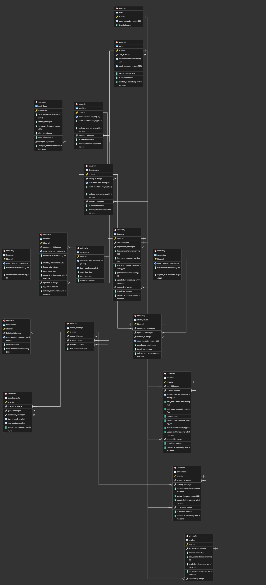
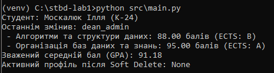

# stbd-lab1
Лабораторна робота №1 з дисципліни "Сучасні технології баз даних"

## Тема

Предметна область - облік навчального процесу в університеті (деканат): факультети, кафедри, групи, студенти, викладачі, дисципліни, запис на дисципліни, оцінки, розклад.

СУБД: PostgreSQL 18. Код: Python 3 + psycopg2.

## Структура проєкту

```
docs/erd.png        - схема бази даних
sql/schema.sql      - таблиці
sql/funcs.sql       - функції, тригери, view, процедури
sql/indexes.sql     - індекси
sql/seed_data.sql   - тестові дані
src/main.py         - Repository + Unit of Work
```

## Схема бази даних



Всі таблиці лежать у схемі `university`. Всього 17 сутностей:

| Таблиця | Що зберігає |
|---|---|
| roles | ролі користувачів (admin, teacher, student) |
| users | облікові записи |
| faculties | факультети |
| departments | кафедри |
| specialties | спеціальності |
| teachers | викладачі |
| study_groups | академічні групи |
| students | студенти |
| courses | дисципліни |
| semesters | семестри |
| course_offerings | дисципліна в конкретному семестрі у конкретного викладача |
| enrollments | запис студента на дисципліну |
| grades | оцінки |
| buildings | корпуси |
| classrooms | аудиторії |
| schedule_slots | розклад занять |
| audit_logs | журнал змін |

### Soft delete

Поля `is_deleted` та `deleted_at` є в таблицях `faculties`, `departments`, `teachers`, `study_groups`, `students`, `courses`, `enrollments`.

Для студентів фізичне видалення заборонене тригером `trg_students_prevent_delete`, видаляти треба через процедуру `sp_soft_delete_student`. Вона позначає студента видаленим, деактивує його обліковий запис і знімає з дисциплін, які він ще не закрив.

### Дата останньої зміни і користувач

Поля `updated_at` та `updated_by` є в таблицях `faculties`, `departments`, `teachers`, `students`, `courses`, `enrollments`, `grades`. Їх заповнює тригер перед кожним INSERT/UPDATE.

Щоб тригер знав, хто саме змінює дані, застосунок на початку транзакції записує id користувача в змінну сесії `app.current_user_id`, а функція `fn_get_current_user_id()` її читає.

Додатково всі зміни в `students` та `enrollments` пишуться в `audit_logs` (старе і нове значення рядка у форматі JSONB).

## Збережені процедури, функції, тригери, view

Функції:

- `fn_get_current_user_id()` - повертає id поточного користувача зі змінної сесії
- `fn_calculate_student_gpa(student_id)` - середній бал студента, зважений за кредитами ECTS

Тригерні функції та тригери:

- `trg_fn_set_audit_fields` - заповнює `updated_at` і `updated_by` (тригери на 7 таблицях)
- `trg_fn_log_entity_changes` - пише зміни в `audit_logs` (тригери на `students` і `enrollments`)
- `trg_fn_prevent_hard_delete` - забороняє DELETE для `students`
- `trg_fn_compute_ects_grade` - за балом виставляє оцінку ECTS (A, B, C, D, E, FX, F) у `grades`

View:

- `vw_active_students` - невидалені студенти з групою, спеціальністю, кафедрою, факультетом і тим, хто останній змінював запис
- `vw_student_transcript` - відомість успішності: студент, дисципліна, викладач, семестр, оцінка
- `vw_teacher_workload` - навантаження викладачів по семестрах

Процедури:

- `sp_register_student` - створює користувача і студента
- `sp_soft_delete_student` - м'яке видалення студента
- `sp_enroll_student_in_offering` - запис на дисципліну з перевіркою ліміту місць; якщо студент вже був записаний і запис видалено, він відновлюється
- `sp_set_student_grade` - виставляє або змінює оцінку і закриває запис на дисципліну

## Індекси

- `idx_students_active_group_lastname` - частковий B-tree індекс по `(group_id, last_name)` тільки для невидалених студентів, для списку групи
- `idx_students_card_hash` - HASH індекс по номеру студентського квитка, для пошуку за точним значенням

## Робота з БД з коду

У `src/main.py` реалізовано Repository + Unit of Work:

- `StudentRepository` - реєстрація, м'яке видалення, читання студентів
- `AcademicProgressRepository` - запис на дисципліну, оцінки, відомість, середній бал
- `UniversityUnitOfWork` - відкриває з'єднання і транзакцію, створює обидва репозиторії на одному курсорі, робить `commit` або `rollback`

Репозиторії не звертаються до таблиць напряму. Запис іде через процедури (`CALL sp_...`), читання через view (`vw_active_students`, `vw_student_transcript`) і функцію `fn_calculate_student_gpa`.

Сценарій у `main.py`:

1. в одній транзакції реєструється студент, записується на дві дисципліни і отримує оцінки
2. виводяться дані студента, відомість і середній бал
3. студент видаляється через soft delete, після чого у `vw_active_students` його вже немає

### Результат виконання



## Запуск

1. Створити базу `stbd_lab1`.
2. Виконати по черзі `sql/schema.sql`, `sql/funcs.sql`, `sql/indexes.sql`, `sql/seed_data.sql`.
3. Встановити залежності і запустити:

```
pip install -r src/requirements.txt
python src/main.py
```

Параметри підключення задаються в `main.py` у змінній `DB_DSN`.
